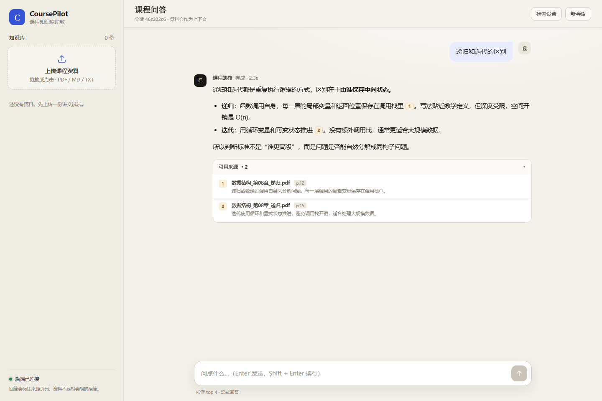

# CoursePilot

CoursePilot 是一个课程知识库 Agent 助教。它把课程 PDF、Markdown 和 TXT
转换为可检索的向量知识库，并通过 DeepSeek 生成带来源编号的回答。课程证据
不足时可以按配置使用 MCP 网页搜索补证，否则明确拒答。



## 当前能力

- 上传 PDF、Markdown、TXT，单文件限制 20MB。
- 使用 MinerU 解析 PDF，支持 Markdown、TXT 直接读取。
- 按 Markdown 标题层级切分文档，保留章节元数据。
- 使用 DashScope Embedding 生成向量，并持久化到 Chroma。
- Supervisor 将请求路由为 direct、clarify、refuse 或 course_query。
- 课程检索使用确定性向量检索，证据不足时可进入 MCP 网页研究 Agent。
- 根据向量距离过滤低相关片段，避免把所有候选都交给模型。
- 检索结果附 `[1]`、`[2]` 编号，前端可展示来源卡片。
- 检索不足时直接拒答，不调用生成模型编造无依据回答。
- 使用 LangGraph `StateGraph` 编排路由、检索、网页研究和回答节点。
- 使用 Async SQLite Checkpointer 按 `session_id` 持久化多轮状态。
- 提供 FastAPI SSE 流式接口，并由 FastAPI 直接托管前端。
- 使用 pytest 覆盖 API、入库、检索、拒答和 Agent 事件转换。

## 架构

```text
文档入库
PDF / MD / TXT
  → MinerU / 文本读取
  → Markdown 切分
  → DashScope Embedding
  → Chroma 持久化

问答
用户问题 + 会话历史
  → Supervisor 路由与独立检索查询
  → direct / clarify / refuse / course_query
  → 确定性课程向量检索
  → 课程证据门控
       ├── 证据充分：合并课程证据
       ├── 证据不足：MCP 网页研究 Agent（可选）
       └── 不可联网或仍不足：refusal
  → 统一 Answer Agent
  → 引用校验与修复
  → SQLite Checkpoint
  → SSE 输出
```

当前采用“Supervisor 编排的课程优先 Agentic RAG”：

1. `supervisor` 结合历史完成路由，并为课程问题生成独立检索查询。
2. 课程检索是确定性节点，避免为一个固定检索工具增加无意义的模型循环。
3. `course_evidence_gate` 根据向量阈值决定直接回答、网页补证或拒答。
4. `web_research` 是拥有 MCP 工具的最小权限 Agent，只能返回结构化网页证据。
5. `answer` 统一基于带编号证据生成回答，`verify_citations` 负责引用安全。
6. `AsyncSqliteSaver` 保存消息、研究证据和路由状态，同一 `session_id` 可恢复上下文。

## 技术栈

| 模块 | 技术 |
|---|---|
| Web API | FastAPI、Uvicorn |
| Agent | LangGraph `StateGraph`、LangChain 1.x |
| 外部工具 | MCP、`langchain-mcp-adapters` |
| LLM | DeepSeek `deepseek-chat`（OpenAI 兼容接口） |
| Embedding | DashScope `text-embedding-v4` |
| PDF 解析 | MinerU API |
| 向量数据库 | Chroma |
| 文本切分 | `langchain-text-splitters` |
| 前端 | 原生 HTML、CSS、JavaScript，SSE |
| 测试 | pytest、FastAPI TestClient |

## 目录结构

```text
CoursePilot/
├── backend/
│   ├── app/
│   │   ├── agents/
│   │   │   ├── state.py           # 可序列化的图状态
│   │   │   ├── nodes.py           # 检索、生成、引用校验等节点
│   │   │   ├── edges.py           # 证据和引用条件路由
│   │   │   ├── build.py           # StateGraph 组装与编译
│   │   │   └── course_tutor.py    # 图工厂与 Async SQLite Checkpointer
│   │   ├── api/
│   │   │   └── routes.py          # health、文档上传、聊天 SSE
│   │   ├── core/
│   │   │   └── config.py          # 环境变量与路径配置
│   │   ├── services/
│   │   │   ├── RAG_services.py    # 加载、切分、Embedding、Chroma
│   │   │   ├── retrieval.py       # 相关性过滤、sources、context
│   │   │   ├── rag_chat.py        # 固定 RAG 回答与 ChatOpenAI
│   │   │   └── agent_chat.py      # Agent 流式事件适配
│   │   ├── schemas.py
│   │   └── main.py
│   ├── tests/
│   └── requirements.txt
├── frontend/
│   ├── index.html
│   ├── app.js
│   └── styles.css
├── data/chroma/                   # 本地 Chroma 数据，不提交 Git
├── data/session/                  # SQLite 会话状态，不提交 Git
├── .env.example
└── README.md
```

## 本地启动

要求 Python 3.10+。以下命令适用于 Windows PowerShell。

```powershell
cd path\to\CoursePilot

python -m venv .venv
.\.venv\Scripts\Activate.ps1

python -m pip install -r backend\requirements.txt
Copy-Item .env.example .env
```

编辑根目录 `.env`，填写 DeepSeek、DashScope 和 MinerU 凭证：

```dotenv
DEEPSEEK_API_KEY=your_deepseek_key
DEEPSEEK_BASE_URL=https://api.deepseek.com
DEEPSEEK_CHAT_MODEL=deepseek-chat

DASHSCOPE_API_KEY=your_dashscope_key
EMBEDDING_MODEL=text-embedding-v4

MINERU_API_KEY=your_mineru_key
MINERU_API_URL=https://mineru.net/api
MINERU_TIER=standard

CHROMA_DIR=data/chroma
SESSION_DB_PATH=data/session/langgraph.sqlite
TOP_K=4
RETRIEVAL_MAX_DISTANCE=1.1

WEB_SEARCH_ENABLED=false
WEB_SEARCH_MCP_CONFIG=
```

兼容旧的 `MINERU_TOKEN` 变量名，但推荐统一使用 `MINERU_API_KEY`。

启用网页补证时，将 `WEB_SEARCH_ENABLED=true`，并把
`WEB_SEARCH_MCP_CONFIG` 设置为 `MultiServerMCPClient(connections=...)`
接受的 JSON 对象。未配置 MCP 时，课程证据不足会直接拒答。

启动服务：

```powershell
cd backend
python -m uvicorn app.main:app --reload --host 127.0.0.1 --port 8000
```

访问：

- 前端：<http://127.0.0.1:8000/>
- Swagger：<http://127.0.0.1:8000/docs>
- 健康检查：<http://127.0.0.1:8000/api/v1/health>

## API

### `GET /api/v1/health`

检查服务是否在线，不依赖模型 API Key。

```json
{
  "status": "ok"
}
```

### `POST /api/v1/documents`

使用 `multipart/form-data`，字段名为 `file`。

支持：

```text
.pdf
.md
.txt
```

成功响应：

```json
{
  "doc_id": "f36bf7226c2a46f7831b7e1ee42ab8ab",
  "file_name": "lecture.md",
  "chunks": 2,
  "status": "ready"
}
```

### `POST /api/v1/chat`

请求：

```json
{
  "session_id": "session-id",
  "question": "递归和迭代有什么区别？",
  "top_k": 4,
  "allow_web": true
}
```

`allow_web` 是用户侧开关，最终还会与服务端 `WEB_SEARCH_ENABLED` 同时生效。

响应类型为 `text/event-stream`：

| 事件 | 数据 |
|---|---|
| `meta` | `{"session_id": "..."}` |
| `status` | `{"message": "当前处理阶段"}` |
| `sources` | `{"sources": [...]}` |
| `token` | `{"text": "增量文本"}` |
| `replace` | `{"text": "修正后的完整回答"}` |
| `refusal` | `{"reason": "..."}` |
| `done` | `{"latency_ms": 1234}` |
| `error` | `{"message": "..."}` |

来源格式：

```json
{
  "index": 1,
  "source_type": "course",
  "file_name": "lecture.md",
  "page": 1,
  "snippet": "递归函数需要基准情形和递归关系。"
}
```

`sources[].index` 与回答中的 `[1]`、`[2]` 一一对应。
网页来源使用 `source_type="web"` 并包含 `title`、`url`。

## 测试

```powershell
cd path\to\CoursePilot\backend
..\.venv\Scripts\python.exe -m pytest -q
```

测试使用假模型和假向量库隔离外部 API。当前测试覆盖：

- health、未知 API 和前端静态托管。
- 上传参数校验与 mock 入库。
- 文档切分和 MinerU 返回适配。
- 相关性过滤、sources 编号和拒答。
- 固定 RAG 提示词与流式 token。
- Supervisor 路由、确定性课程检索、MCP 网页补证和引用修复。
- Async SQLite Checkpointer 的跨请求消息恢复。
- Agent sources/token/replace/refusal 事件映射。
- `/chat` 的 `meta/sources/token/replace/refusal/done/error` 契约。

## 设计说明

- API 路由在静态前端挂载之前注册，避免 `/api` 请求被 StaticFiles 吞掉。
- Chroma 通过 `get_vector_store()` 延迟创建，导入模块时不会连接数据库或 API。
- 阻塞型 PDF 解析、Embedding 和检索通过线程池执行，避免阻塞 FastAPI 事件循环。
- 模型和向量库不依赖当前工作目录，`.env` 从项目根目录读取。
- `.env`、`.venv`、上传文件和 Chroma 数据均已加入 `.gitignore`。

## 已知限制

- PDF 页码尚未随切分片段保存，当前 PDF/Markdown 来源的 `page` 会回退为 `1`。
- 暂未实现文档删除、重复上传去重和多用户隔离。
- 暂未实现检索评测集、引用准确率统计和 LangSmith 链路追踪。
- 暂未提供 Docker 部署。
- `langchain-community` 已进入 sunset 阶段，后续应迁移到独立集成包。

## 后续计划

1. 保留 PDF 页码和章节元数据，实现准确的页码引用。
2. 增加文档元数据、删除、去重和增量更新。
3. 建立课程问答评测集，评估路由、检索召回率、引用准确率和拒答率。
4. 增加 MCP 搜索缓存、域名策略、超时和工具调用审计。
5. 增加 Docker、日志和基础可观测性。
