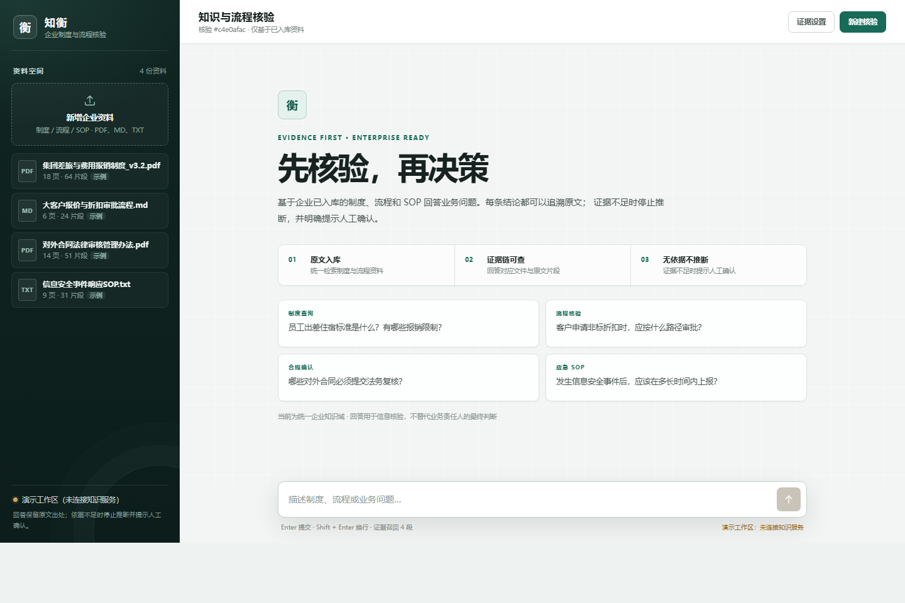

# 知衡（Zhiheng）

知衡是一个面向企业的制度、流程与业务知识核验台。它将 PDF、Markdown 和 TXT 资料转换为可检索的知识库，通过 Agentic RAG 生成带来源编号的回答；当已有资料不足以支撑结论时，系统会停止推断并提示人工确认。



## 项目定位

知衡重点解决企业内部信息查询中的三个问题：

- **找不到**：制度、流程和 SOP 分散在多个文件中。
- **不敢信**：普通聊天模型无法说明结论来自哪份资料的哪一段。
- **容易编**：资料没有覆盖的问题被模型用常识补齐，形成错误制度解释。

当前产品叙事已经切换为企业知识核验，但后端仍保留原有 API 字段和内部字段名。诸如 `course_query`、`source_type=course` 等名称属于兼容标识，语义上对应企业内部资料，不代表课程场景。

## 当前能力

- 上传 PDF、Markdown、TXT，单文件限制 20MB。
- 使用 MinerU 解析 PDF，Markdown 和 TXT 直接读取。
- 按 Markdown 标题层级切分文档，并保留章节与文件元数据。
- 使用 DashScope Embedding 生成向量，并持久化到 Chroma。
- Supervisor 将请求路由为 `direct`、`clarify`、`refuse` 或 `course_query`。
- 企业资料查询使用确定性向量检索，不经过额外研究 Agent。
- 根据向量距离过滤低相关片段，避免把所有候选都交给模型。
- 检索结果附 `[1]`、`[2]` 编号，前端展示可追溯证据链。
- 资料不足时明确停止推断，不调用生成模型编造答案。
- 资料不足且配置了 MCP 时，可搜索公开网页补充证据。
- 使用 LangGraph `StateGraph` 编排路由、检索、网页研究、回答和引用校验。
- 使用 Async SQLite Checkpointer 按 `session_id` 持久化多轮状态。
- 提供 FastAPI SSE 流式接口，并由 FastAPI 直接托管前端。
- 使用 pytest 覆盖 API、入库、检索、拒答和 Agent 事件转换。

## 企业化身份

模型身份由后端系统提示词统一控制：

- 产品名称：**知衡**
- 角色：企业制度与流程核验助手
- 回答范围：企业已入库制度、流程、SOP、产品资料和业务文件
- 引用原则：事实性结论必须对应实际证据编号
- 拒答原则：依据不足或证据冲突时停止推断，提示补充资料或人工确认

直接回答、澄清、证据回答、网页研究以及独立 RAG 提示词均已使用统一的企业身份。

## 架构

```text
企业资料入库
PDF / MD / TXT
   ↓
MinerU / 文本读取
   ↓
Markdown 切分
   ↓
DashScope Embedding
   ↓
Chroma 持久化

业务核验
用户问题 + 会话历史
   ↓
Supervisor 路由与独立检索查询
   ↓
direct / clarify / refuse / course_query
   ↓
确定性企业资料向量检索
   ↓
证据门控
   ├── 证据充分：合并企业资料证据
   ├── 证据不足：MCP 公开网页研究（可选）
   └── 不可联网或仍不足：停止推断
   ↓
统一 Answer Agent
   ↓
引用校验与修复
   ↓
SQLite Checkpoint
   ↓
SSE 输出
```

核心执行流程：

1. `supervisor` 结合历史完成路由，并为企业资料问题生成独立检索查询。
2. 企业资料检索是确定性节点，不由模型循环调用工具。
3. `course_evidence_gate` 根据向量阈值决定直接回答、网页补证或停止推断。
4. `web_research` 仅在配置 MCP 且允许联网时启用。
5. `answer` 统一基于带编号证据生成回答。
6. `verify_citations` 校验引用是否来自本轮证据。
7. `AsyncSqliteSaver` 保存消息、研究证据和路由状态。

## 技术栈

| 模块 | 技术 |
|---|---|
| Web API | FastAPI、Uvicorn |
| Agent | LangGraph `StateGraph`、LangChain 1.x |
| 外部工具 | MCP、`langchain-mcp-adapters` |
| LLM | DeepSeek OpenAI 兼容接口 |
| Embedding | DashScope `text-embedding-v4` |
| PDF 解析 | MinerU API |
| 向量数据库 | Chroma |
| 文本切分 | `langchain-text-splitters` |
| 前端 | 原生 HTML、CSS、JavaScript、SSE |
| 测试 | pytest、FastAPI TestClient |

## 目录结构

```text
CoursePilot/
├── start.py                      # 项目启动脚本
├── backend/
│   ├── app/
│   │   ├── agents/
│   │   │   ├── state.py          # 可序列化的图状态
│   │   │   ├── nodes.py          # 企业提示词、检索、回答与引用校验节点
│   │   │   ├── edges.py          # 证据和引用条件路由
│   │   │   ├── build.py          # StateGraph 组装与编译
│   │   │   └── course_tutor.py   # Agent 工厂，保留内部兼容命名
│   │   ├── api/
│   │   │   └── routes.py         # health、文档上传、聊天 SSE
│   │   ├── core/
│   │   │   └── config.py         # 环境变量与路径配置
│   │   ├── services/
│   │   │   ├── RAG_services.py   # 加载、切分、Embedding、Chroma
│   │   │   ├── retrieval.py      # 相关性过滤、sources、context
│   │   │   ├── rag_chat.py       # 基础 RAG 回答与模型工厂
│   │   │   └── agent_chat.py     # Agent 流式事件适配
│   │   ├── schemas.py
│   │   └── main.py
│   ├── tests/
│   └── requirements.txt
├── frontend/
│   ├── index.html                # 知衡企业核验工作台
│   ├── app.js                    # 上传、核验、SSE、Markdown 与演示数据
│   ├── styles.css                # 企业视觉与响应式布局
│   ├── preview-enterprise.png    # 企业版预览
│   ├── mock_server.py            # 原有接口契约的 mock 服务
│   └── README.md
├── data/
│   ├── chroma/                   # 本地 Chroma 数据，不提交 Git
│   └── session/                  # SQLite 会话状态，不提交 Git
├── .env.example
└── README.md
```

## 快速启动

要求 Python 3.10+。

### 一键启动

推荐在项目根目录运行：

```powershell
python start.py
```

启动脚本会自动：

1. 在缺少 `.venv` 时创建虚拟环境。
2. 检查后端运行依赖，缺少时安装 `backend/requirements.txt`。
3. 在缺少 `.env` 时从 `.env.example` 创建配置文件。
4. 创建 Chroma、会话和上传数据目录。
5. 启动 Uvicorn，并自动打开浏览器。

可选参数：

```powershell
python start.py --port 8001
python start.py --no-reload
python start.py --no-browser
python start.py --help
```

默认地址：

- 前端：<http://127.0.0.1:8000/>
- Swagger：<http://127.0.0.1:8000/docs>
- 健康检查：<http://127.0.0.1:8000/api/v1/health>

按 `Ctrl+C` 停止服务。

### 手动启动

如果不使用启动脚本：

```powershell
python -m venv .venv
.\.venv\Scripts\Activate.ps1
python -m pip install -r backend\requirements.txt
Copy-Item .env.example .env
```

编辑项目根目录 `.env`，填写 DeepSeek、DashScope 和 MinerU 凭证：

```dotenv
DEEPSEEK_API_KEY=your_deepseek_key
DEEPSEEK_BASE_URL=https://api.deepseek.com
DEEPSEEK_CHAT_MODEL=deepseek-chat

DASHSCOPE_API_KEY=your_dashscope_key
EMBEDDING_MODEL=text-embedding-v4

MINERU_API_KEY=your_mineru_key
MINERU_API_URL=https://mineru.net/api
MINERU_TIER=standard

CHROMA_DIR=data/chroma
SESSION_DB_PATH=data/session/langgraph.sqlite
TOP_K=4
RETRIEVAL_MAX_DISTANCE=1.1

WEB_SEARCH_ENABLED=false
WEB_SEARCH_MCP_CONFIG=
```

启动后端：

```powershell
cd backend
..\.venv\Scripts\python.exe -m uvicorn app.main:app --reload --host 127.0.0.1 --port 8000
```

FastAPI 会直接托管 `frontend/`，因此无需额外启动前端服务。

## API

### `GET /api/v1/health`

检查服务是否在线，不依赖模型 API Key。

```json
{
  "status": "ok"
}
```

### `POST /api/v1/documents`

使用 `multipart/form-data`，字段名为 `file`。

支持：

```text
.pdf
.md
.txt
```

成功响应：

```json
{
  "doc_id": "f36bf7226c2a46f7831b7e1ee42ab8ab",
  "file_name": "大客户报价与折扣审批流程.md",
  "chunks": 24,
  "status": "ready"
}
```

### `POST /api/v1/chat`

请求：

```json
{
  "session_id": "session-id",
  "question": "客户申请非标折扣时，应按什么路径审批？",
  "top_k": 4,
  "allow_web": false
}
```

`allow_web` 是用户侧开关，最终还会与服务端 `WEB_SEARCH_ENABLED` 同时生效。

响应类型为 `text/event-stream`：

| 事件 | 数据 |
|---|---|
| `meta` | `{"session_id": "..."}` |
| `status` | `{"message": "当前处理阶段"}` |
| `sources` | `{"sources": [...]}` |
| `token` | `{"text": "增量文本"}` |
| `replace` | `{"text": "修正后的完整回答"}` |
| `refusal` | `{"reason": "..."}` |
| `done` | `{"latency_ms": 1234}` |
| `error` | `{"message": "..."}` |

来源格式：

```json
{
  "index": 1,
  "source_type": "course",
  "file_name": "大客户报价与折扣审批流程.md",
  "page": 4,
  "snippet": "低于标准折扣下限的报价，须经财务测算并由事业部总经理审批。"
}
```

`source_type=course` 是保留的兼容字段，实际表示企业内部资料。`sources[].index` 与回答中的 `[1]`、`[2]` 一一对应；网页来源使用 `source_type="web"` 并包含 `title` 和 `url`。

## 测试

```powershell
cd backend
..\.venv\Scripts\python.exe -m pytest -q
```

测试使用假模型和假向量库隔离外部 API。当前覆盖：

- health、未知 API 和前端静态托管。
- 上传参数校验与 mock 入库。
- 文档切分和 MinerU 返回适配。
- 相关性过滤、sources 编号和企业资料拒答文案。
- 知衡系统身份与基础 RAG 提示词。
- Supervisor 路由、确定性检索、MCP 网页补证和引用修复。
- Async SQLite Checkpointer 的跨请求消息恢复。
- Agent sources/token/replace/refusal 事件映射。
- `/chat` 的 `meta/sources/token/replace/refusal/done/error` 契约。

## 设计说明

- API 路由在静态前端挂载之前注册，避免 `/api` 请求被 `StaticFiles` 吞掉。
- Chroma 通过 `get_vector_store()` 延迟创建，导入模块时不会连接数据库或 API。
- 阻塞型 PDF 解析、Embedding 和检索通过线程池执行。
- 模型和向量库路径不依赖当前工作目录，`.env` 始终从项目根目录读取。
- 前端兼容原 SSE 契约，企业化改造主要集中在前端展示与后端提示词语义。
- 内部类名和路由名保留了部分 `course_*` 命名，用于降低接口与测试迁移风险。

## 已知限制

- PDF 页码尚未随切分片段完整保留，当前 PDF/Markdown 来源页码可能回退为 `1`。
- 暂未实现文档删除、列表查询、重复上传去重和多用户隔离。
- 当前向量库是统一知识域，不具备部门权限、租户隔离或真实审计日志。
- 暂未实现检索评测集、引用准确率统计和 LangSmith 链路追踪。
- 网页补证需要额外配置 MCP，未配置时企业资料不足会直接停止推断。
- 暂未提供 Docker 部署。
- `langchain-community` 已进入 sunset 阶段，后续应迁移到独立集成包。

## 后续计划

1. 保留 PDF 页码和章节元数据，实现准确的证据定位。
2. 增加文档列表、删除、去重和增量更新接口。
3. 增加登录、部门知识域、租户隔离和审计日志。
4. 建立企业问答评测集，评估路由、召回率、引用准确率和拒答率。
5. 增加 MCP 搜索缓存、域名策略、超时和工具调用审计。
6. 增加 Docker、结构化日志和基础可观测性。
