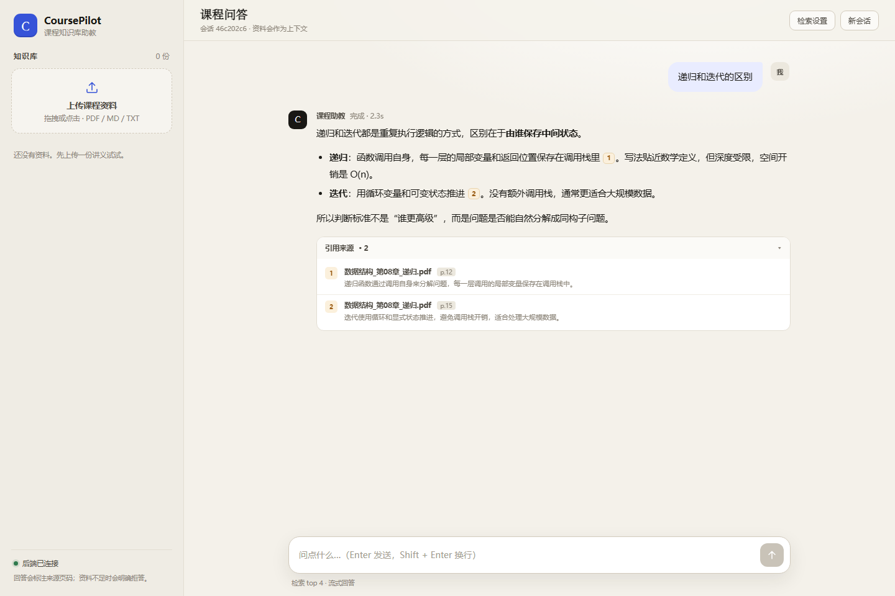

# CoursePilot 前端

课程知识库助教的聊天界面。零构建、零 CDN，纯 HTML / CSS / JavaScript，后端用 FastAPI 托管即可。



## 本地预览

```bash
python frontend/mock_server.py
```

打开 <http://127.0.0.1:8765>。

`mock_server.py` 同时提供静态文件和假数据接口，用来验证交互、SSE 流式解析和上传进度。没有启动后端时，直接双击 `index.html` 也会自动进入演示模式（会预置 3 份示例资料）。

## 文件

```text
frontend/
  index.html       页面结构
  styles.css       视觉样式与响应式布局
  app.js           上传、聊天、SSE 解析、Markdown 渲染、演示数据
  mock_server.py   本地联调用 mock 服务（仅标准库）
```

## 后端接口契约

### `GET /api/v1/health`

```json
{ "status": "ok" }
```

前端据此切换「已连接」和「演示模式」。

### `POST /api/v1/documents`

`multipart/form-data`，字段名 `file`。

```json
{ "doc_id": "doc-1", "file_name": "lecture.pdf", "pages": 24, "chunks": 71 }
```

上传过程中前端用 XHR 的 `upload.onprogress` 显示进度。

### `POST /api/v1/chat`

请求：

```json
{ "session_id": "uuid", "question": "递归和迭代的区别？", "top_k": 4 }
```

响应：`text/event-stream`，每个事件以空行结尾。

| event | data | 说明 |
|---|---|---|
| `meta` | `{"session_id": "..."}` | 会话 ID，可覆盖前端生成的临时 ID |
| `sources` | `{"sources": [...]}` | 检索结果，建议在 token 之前发送 |
| `token` | `{"text": "增量文本"}` | 流式生成片段 |
| `refusal` | `{"reason": "..."}` | 检索不足，前端展示拒答卡片 |
| `done` | `{"latency_ms": 1234}` | 本轮结束 |
| `error` | `{"message": "..."}` | 统一错误出口 |

`sources` 中每一项：

```json
{
  "index": 1,
  "file_name": "数据结构_第08章_递归.pdf",
  "page": 12,
  "snippet": "递归函数通过调用自身来分解问题……"
}
```

`index` 必须和回答里的 `[1]` 对应。前端只把存在于 `sources` 里的编号渲染成可点击引用。

Python 端一个最小的 SSE 写法：

```python
def sse(event: str, data: dict) -> str:
    return f"event: {event}\ndata: {json.dumps(data, ensure_ascii=False)}\n\n"

@app.post("/api/v1/chat")
async def chat(body: ChatRequest):
    async def generate():
        yield sse("meta", {"session_id": body.session_id})
        yield sse("sources", {"sources": sources})
        async for token in stream_answer(body.question):
            yield sse("token", {"text": token})
        yield sse("done", {"latency_ms": elapsed})

    return StreamingResponse(generate(), media_type="text/event-stream")
```

## 挂到 FastAPI

先注册所有 `/api` 路由，再挂静态目录（顺序不能反）：

```python
from fastapi.staticfiles import StaticFiles

app.mount("/", StaticFiles(directory="frontend", html=True), name="frontend")
```

开发阶段建议前端单独跑 `mock_server.py`，在 `app.js` 里把 `API_BASE` 指向 `http://127.0.0.1:8000/api/v1` 即可；生产环境同源部署时无需修改。

## 已处理的边界

- 流式解析兼容 `\n` 与 `\r\n`，忽略心跳注释行，处理跨 chunk 的半截事件。
- Markdown 先转义再渲染，引用编号只认本轮 `sources`，避免 XSS 和模型伪造引用。
- 引用点击会展开来源卡片并高亮对应片段。
- 上传限制 20MB，只接受 PDF / MD / TXT；失败会从列表回滚。
- 断线、HTTP 错误、后端 `error` 事件都会落到同一条错误展示路径。
- 侧栏在窄屏变为抽屉，支持 Esc 关闭；`prefers-reduced-motion` 下关闭动画。
